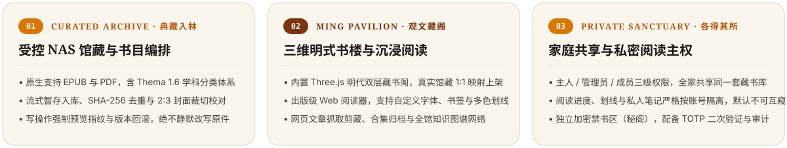
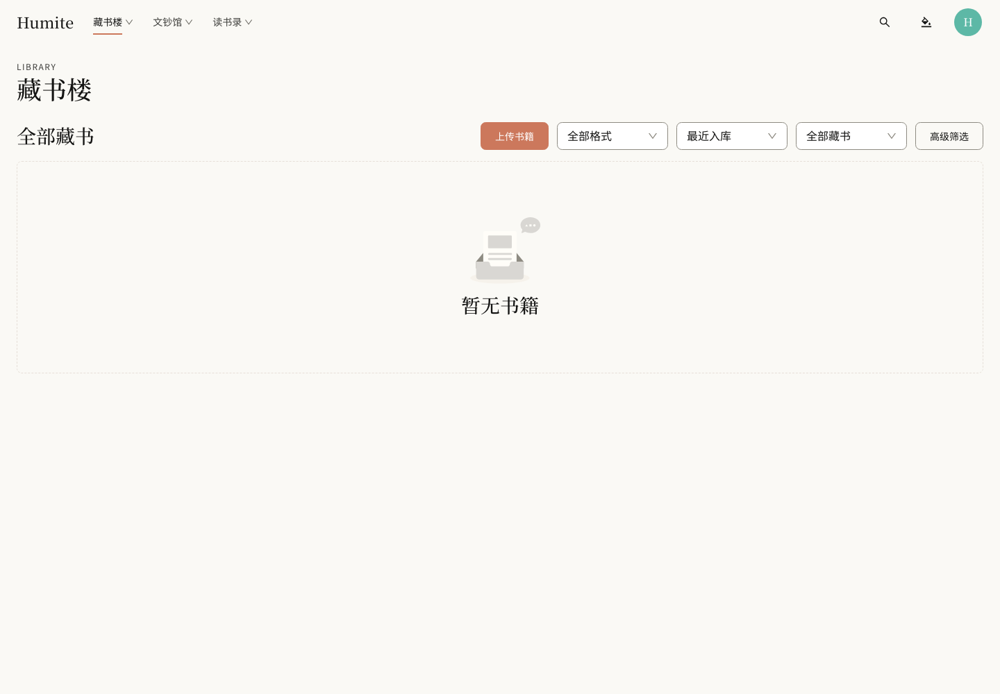
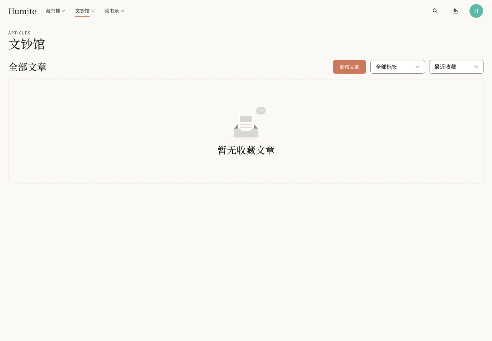

<div align="center">


<br />

[](package.json)
[](https://github.com/johntao2004/Silvae/actions/workflows/ci.yml)
[](https://github.com/johntao2004/Silvae/actions/workflows/docker.yml)
[](LICENSE)
[](apps/server/pom.xml)
[](apps/web/package.json)
[](#-观文藏阁--三维明式虚拟书楼)

**[快速安装](#-快速安装docker-一键部署) · [观文藏阁](#-观文藏阁--三维明式虚拟书楼) · [阅读与编目](#-阅读与编目体验) · [环境变量](#-环境变量速查) · [源码开发](#-源码开发) · [开源许可](#-开源许可)**

</div>

<br />

<div align="center">
  
</div>

> **Humite（书林） v1.0.0** 是一座面向家庭与个人的自托管 NAS 数字藏书阁。它将散落在存储目录中的 **EPUB** 与 **PDF** 1:1 映射进两层明代宫殿式三维藏书楼 **「观文藏阁」**，全家人共享同一套书目典藏与编目整理，而每个人的阅读进度、划线批注、随笔笔记与加密书库则严格按账号隔离。

---

## 🚀 快速安装（Docker 一键部署）

Humite 已将 Web 前端、三维明式书楼、Spring Boot API 与后台 Worker 完整封装进 Docker 镜像，配合 PostgreSQL 开箱即用，**无需在宿主机安装 Node.js、Java 或本地数据库**（仅需 Docker Engine 与 Docker Compose v2）。

### 方式一：一键脚本部署（推荐）

```bash
git clone https://github.com/johntao2004/Silvae.git humite
cd humite
bash docker/deploy.sh
```

脚本会自动完成以下工作：
1. 若当前目录尚无 `.env`，自动复制 `.env.example` 并随机生成数据库密码（`POSTGRES_PASSWORD`）与 256 位加密密钥。
2. 自动创建 `HUMITE_LIBRARY_MAIN` 对应的宿主机书库目录（默认 `./data/library`）。
3. 自动拉取预构建镜像（或当远程镜像暂不可用时自动切换为本地多阶段构建），启动 `postgres`、`app`、`worker` 全部容器并等待健康检查就绪。

> 若希望强制从本地源码重新构建镜像，可运行 `bash docker/deploy.sh --build`。

### 方式二：Docker Compose 手动部署

```bash
git clone https://github.com/johntao2004/Silvae.git humite
cd humite
cp .env.example .env
```

编辑 `.env`，**至少配置以下两项必填参数**：
- **`POSTGRES_PASSWORD`**：数据库密码，**必须填写强密码**（`compose.yaml` 会校验非空，未设置时拒绝启动）。
- **`HUMITE_LIBRARY_MAIN`**：宿主机电子书根目录（默认 `./data/library`；NAS 部署请修改为实际藏书目录，例如 `/volume1/books`，并按需调整 `HUMITE_UID` / `HUMITE_GID` 与目录属主一致）。

确认目录存在后启动服务：

```bash
mkdir -p ./data/library   # 若已指向现有 NAS 目录可跳过
docker compose up -d
```

> 如需从本地源码构建镜像再启动，可执行 `docker compose up -d --build`。

### 首次启动与日常运维

- **创建主人（Owner）账号**：服务就绪后在浏览器打开 **`http://localhost:8080/setup`**（若修改过 `HUMITE_HTTP_PORT` 请替换为对应端口），按引导创建首个 **Owner** 账户。完成初始化后即可在管理设置中配置存储目录扫描、家庭成员权限、动态验证码（2FA）加密书库、在线元数据与 AI 辅助。
- **常用容器运维命令**：

| 操作 | 快捷脚本（已安装 pnpm） | 原生 Docker Compose 命令 |
| --- | --- | --- |
| 启动 / 更新服务 | `pnpm docker:up` | `bash docker/deploy.sh` |
| 本地源码重建并启动 | `pnpm docker:build` | `docker compose up -d --build` |
| 查看实时运行日志 | `pnpm docker:logs` | `docker compose logs -f` |
| 停止并移除容器（保留数据卷） | `pnpm docker:down` | `docker compose down` |

- **挂载多个 NAS 书库目录**：可参考 [`docker/compose.multi-root.example.yaml`](docker/compose.multi-root.example.yaml)，使用多文件组合启动：`docker compose -f compose.yaml -f docker/compose.multi-root.example.yaml up -d`。

---

## 🏯 观文藏阁 · 三维明式虚拟书楼

内置基于 Three.js 打造的 **「观文藏阁 · 二层明式藏书空间」**（`apps/web/public/assets/ming-library`），将真实馆藏自动生成可近观、可漫游、可即点即读的三维实体书册，支持第一人称步行漫游、学科分类书架定位、每日读书签卡与四时天色切换。

<p align="center">
  
</p>

<table>
  <tr>
    <td width="33.3%" align="center">
      
      <br />
      <sub><b>宫门入阁 · 文华殿重檐庑殿</b></sub>
    </td>
    <td width="33.3%" align="center">
      
      <br />
      <sub><b>殿堂书林 · 御座中厅与两翼书架</b></sub>
    </td>
    <td width="33.3%" align="center">
      
      <br />
      <sub><b>循架寻书 · 真实书目 1:1 三维陈列</b></sub>
    </td>
  </tr>
</table>

---

## 📖 阅读与编目体验

- **典藏入林与受控文件事务**：支持流式上传 EPUB / PDF、SHA-256 指纹去重、Thema 1.6 国际标准学科分类、Open Library / Wikidata 在线元数据补全与可选 AI 辅助编目；所有 NAS 文件写操作均经过安全预览指纹校验与版本保留回滚。
- **双引擎阅读器与笔记体系**：内置 EPUB / PDF 纸感阅读器、自定义阅读字体、全站一致的纸张 / 亮白 / 夜间主题、全馆知识图谱、公开与共享发现页（书单 / 文章合集），以及账号隔离的多色划线、笔记与随笔。
- **文章剪藏与加密书库**：支持网页文章抓取与阅读整理；加密书库支持浏览器端加密、TOTP 动态验证码访问控制、一次性备用恢复码与完整访问审计。

<p align="center">
  
</p>

<p align="center">
  
</p>

---

## ⚙️ 环境变量速查

完整示例见 [`.env.example`](.env.example)，与 [`compose.yaml`](compose.yaml) 保持一一对应：

| 变量名 | 默认值 | 说明 |
| --- | --- | --- |
| `POSTGRES_DB` | `humite` | PostgreSQL 数据库名称 |
| `POSTGRES_USER` | `humite` | PostgreSQL 数据库用户名 |
| `POSTGRES_PASSWORD` | **必填** | PostgreSQL 数据库密码（`deploy.sh` 自动生成；手动部署必须设置） |
| `HUMITE_LIBRARY_MAIN` | `./data/library` | 宿主机主书库目录，挂载到容器 `/library/main` |
| `HUMITE_LIBRARY_NAME` | `主书库` | 主书库在界面中的显示名称 |
| `HUMITE_HTTP_PORT` | `8080` | 宿主机暴露的 HTTP 访问端口 |
| `HUMITE_PUBLIC_BASE_URL` | `http://localhost:8080` | 外部访问基址（用于邮件找回等回调链接） |
| `HUMITE_COOKIE_SECURE` | `false` | 会话 Cookie 的 `Secure` 标志；经 HTTPS 反向代理对外暴露时请设为 `true` |
| `HUMITE_AI_SETTINGS_ENCRYPTION_KEY` | 自动生成 | AI 平台与邮件密码加密密钥（64 位十六进制），留空由容器在持久化卷自动生成 |
| `HUMITE_TWO_FACTOR_ENCRYPTION_KEY` | 自动生成 | 动态验证码（2FA）密钥（64 位十六进制），留空由容器自动生成 |
| `HUMITE_UPLOAD_MAX_FILE_SIZE` | `2147483648` | 单本电子书上传体积上限（字节，默认 2 GiB） |
| `HUMITE_UPLOAD_MAX_BATCH_FILES` | `20` | 单次批量上传最多文件数 |
| `HUMITE_UPLOAD_RETENTION` | `24h` | 未确认入库的上传暂存保留时长 |
| `HUMITE_UPLOAD_MAX_COVER_SIZE` | `20971520` | 封面图片上传上限（字节，默认 20 MiB） |
| `HUMITE_METADATA_OPEN_LIBRARY_ENABLED` | `true` | 是否默认开启 Open Library 在线书目匹配 |
| `HUMITE_UID` / `HUMITE_GID` | `1000` / `1000` | 容器进程 UID / GID，建议与 NAS 挂载目录权限保持一致 |
| `TZ` | `Asia/Shanghai` | 容器与数据库时区 |

---

## 🛠️ 源码开发

开发环境要求：**Node.js >= 22**、**pnpm 10.33+**、**Java 21** 与 **PostgreSQL 18**。

### 前端工作区（`apps/web`）

```bash
pnpm install
pnpm dev          # 启动 Vite 开发服务器（默认 http://localhost:4173，自动代理 /api 到 8080）
pnpm typecheck    # TypeScript 类型检查
pnpm lint         # ESLint 检查（零警告）
pnpm test         # 运行 Vitest 单元测试
pnpm build        # 构建生产前端产物（输出到 apps/web/dist/client）
```

### 后端服务（`apps/server`）

```bash
./apps/server/mvnw -f apps/server/pom.xml checkstyle:check test
```

### 本地全栈预览与 API 契约

```bash
pnpm start:local   # 打包后端 JAR 并启动本地 API + Worker
pnpm start:preview # 后台托管全栈预览（可用 pnpm status:preview / pnpm stop:preview 控制）
```

- OpenAPI 3.1 接口规范位于 [`docs/openapi/humite-api.yaml`](docs/openapi/humite-api.yaml)，可通过 `pnpm generate:client` 校验并生成 TypeScript 客户端。

---

## 📄 开源许可

Humite 源代码基于 [MIT License](LICENSE) 开源。随附字体与三维场景资产署名详见 [`FONT_SOURCES.md`](apps/web/public/fonts/FONT_SOURCES.md) 与 [`THIRD_PARTY_NOTICES.md`](apps/web/public/assets/ming-library/THIRD_PARTY_NOTICES.md)。
